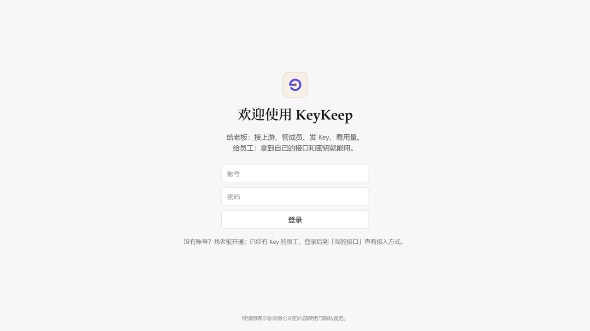
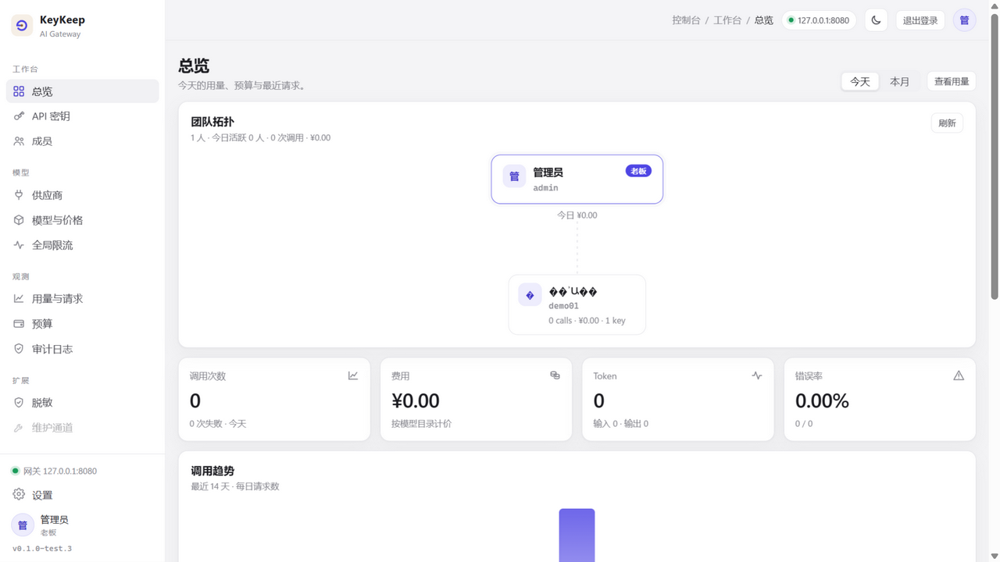
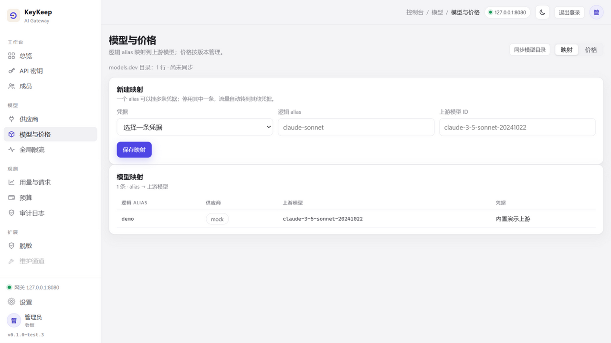
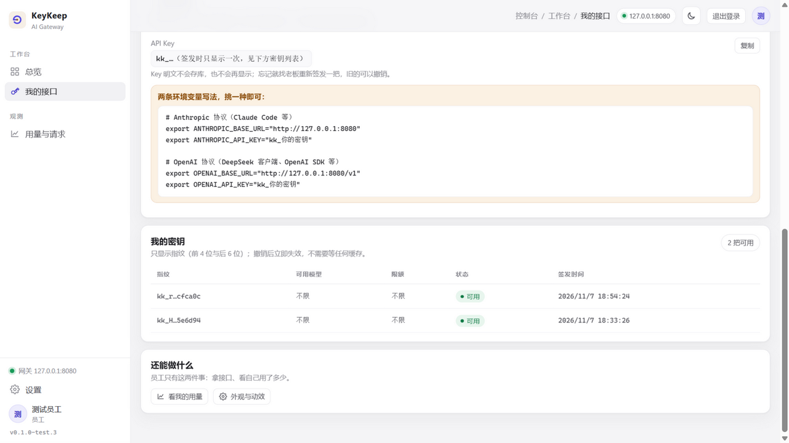

# KeyKeep（钥守）

**版本 `0.1.0-test.6`** · **平台 Windows 10 / 11 x64** · **状态 测试版（Beta，仅供评估）**

**私有化部署的企业 AI API 统一管理与分发软件。**

公司统一保管真实的模型上游凭据，员工只拿到**可撤销、可限额、可审计**的虚拟 Key —— 员工用现有的 AI 工具照常工作，而真实凭据、预算和审计始终握在公司手里。

📥 **[下载最新版本](https://github.com/france-stack/keykeep-releases/releases/latest)**　🌐 **[软件介绍页](https://france-stack.github.io/keykeep-releases/)**　🐛 **[问题反馈](https://github.com/france-stack/keykeep-releases/issues)**

---

## 它解决什么问题

| 没有钥守 | 有了钥守 |
| --- | --- |
| 上游 API Key 直接发给员工，收不回来 | 员工只拿虚拟 Key，随手可撤销，撤销**立即失效** |
| 谁用了多少 token、花了多少钱，没人说得清 | 每次调用按模型计价入账本，费用精确到员工 / Key |
| 疑似泄漏只能全网更换真实 Key | 撤销虚拟 Key 即可，真实凭据永不离开管理面 |
| 预算与用量失控 | 员工级 + 全局级两级预算、Key 级 + 全局级两级限流 |
| 敏感内容随提示词发往上游 | 规则式脱敏，按策略替换后再转发 |

## 核心功能

- **虚拟 Key 分发** — 批量签发、撤销即时生效；明文只在签发时显示一次，之后只显示指纹
- **凭据集中托管** — 真实上游凭据 AES-256-GCM 加密存储，只有管理面可写入
- **多供应商与模型映射** — 逻辑别名映射到上游模型，可多条映射分流；支持 OpenAI / Anthropic 协议、SSE 流式与工具调用
- **两级限流 + 两级预算** — Key 级 / 全局级限流，员工级 / 全局级预算，超限自动拒绝
- **计量账本** — 按模型目录计价，价格支持版本管理，用量可查可核
- **规则式脱敏** — 按规则替换敏感内容后再转发
- **审计日志** — 登录、签发、撤销、调用失败全程留痕
- **员工自助** — 员工登录后自助查看接入方式、自己的 Key 和用量，不经过管理员传话
- **私有化部署** — 凭据、账本、审计数据全部留在本机 / 内网
- **升级与回滚** — 版本目录 + 指针切换，升级包带 Ed25519 签名清单与 SHA-256 校验，失败自动保留旧版，`KeyKeep.exe rollback` 一键回退

## 界面一览

**登录页** —— 管理员与员工同一个入口，登录后各自看到不同的工作台：



**管理员工作台** —— 团队、用量、预算、错误率一屏总览：



**模型与价格** —— 逻辑别名映射到上游模型，价格按版本管理：



**员工侧「我的接口」** —— 拿到接入方式和密钥指纹，自己查用量：



> 以上截图均为内置演示数据。

<!-- VERSION-INFO:START -->
## 版本信息

| 项目 | 值 |
| --- | --- |
| 当前版本 | `0.1.0-test.6` |
| 发布标签 | `v0.1.0-test.6` |
| 发布日期 | 2026-11-07 |
| 通道 | 测试版（Beta，非生产） |
| 平台 | Windows 10 / 11 x64 |
| 最新下载（固定链接） | <https://github.com/france-stack/keykeep-releases/releases/latest> |
| 更新清单（固定链接） | <https://github.com/france-stack/keykeep-releases/releases/latest/download/latest.json> |
| 软件介绍页 | <https://france-stack.github.io/keykeep-releases/> |

<!-- VERSION-INFO:END -->

## 下载

到 **[Releases · Latest](https://github.com/france-stack/keykeep-releases/releases/latest)** 获取最新版（该链接始终指向当前版本，无需记忆版本号）：

| 文件 | 大小（字节） | 说明 |
| --- | --- | --- |
| `KeyKeep-Setup-0.1.0-test.6.exe` | 170,970,118 | 安装器版（推荐）：双击安装，免管理员权限，默认装到 `%LOCALAPPDATA%\KeyKeep` |
| `KeyKeep-0.1.0-test.6-portable.zip` | 254,727,817 | 便携版：解压即用，不写注册表 |
| `keykeep-0.1.0-test.6.zip` | 254,727,817 | OTA 更新包：与便携版**字节完全相同**，供程序内「检查更新」按固定文件名下载，无需手动取用 |
| `SHA256SUMS.txt` | 366 | 4 个文件的 SHA-256 校验值 |
| `latest.json` | 583 | 带 Ed25519 签名的更新清单，供程序内「检查更新」使用 |

两个 zip 的内容与 SHA-256 完全一致，仅文件名不同。`latest.json` 与 OTA 包共同支撑程序内「检查更新」，请勿单独删除这两个附件。

## 校验下载完整性

请**先校验再运行**。把 5 个文件下载到同一目录后：

**PowerShell**

```powershell
Get-Content .\SHA256SUMS.txt | Where-Object { $_.Trim() } | ForEach-Object {
  $expected, $name = $_ -split '\s+', 2
  $actual = (Get-FileHash $name -Algorithm SHA256).Hash.ToLower()
  "{0}  {1}" -f $(if ($actual -eq $expected) { 'OK' } else { 'MISMATCH' }), $name
}
```

**Git Bash / macOS / Linux**

```bash
sha256sum -c SHA256SUMS.txt
```

全部显示 `OK` 方可使用；出现 `MISMATCH` 请重新下载。

## 安装与首次使用

系统要求：Windows 10 / 11 64 位；建议预留 1 GB 以上磁盘空间。

**安装器版**：双击 `KeyKeep-Setup-*.exe`，按向导完成安装（可自定义安装位置，默认 `%LOCALAPPDATA%\KeyKeep`；不需要管理员权限）。

**便携版**：将 zip 解压到任意目录，双击 `KeyKeep.exe`。

1. 首次启动会初始化内置数据库（PostgreSQL 16）与运行时，约 1–2 分钟
2. 打开控制台：<http://127.0.0.1:8443>
3. 管理员账号与初始口令见安装目录下生成的 **「初始登录信息.txt」**，首次登录后请立即修改口令
4. 内置演示上游已就绪：无需真实凭据，登录后即可体验「接入供应商 → 签发 Key → 发起调用 → 查看用量与账单」全流程

> 安装目录中 `data\` 为数据目录（数据库与加密凭据都在这里，请随重要数据一同备份），`logs\` 为日志目录。卸载或升级不会删除 `data\` 与 `settings.json`；请勿手工删除 `settings.json`，否则已加密的上游凭据将无法解开。

## 当前状态：测试版

当前版本 **`0.1.0-test.6`**（2026-11-07）为面向评估的测试版：

- **已包含**：管理控制台（登录、成员、API 密钥、供应商、模型与价格、限流、预算、审计）、员工自助页（我的接口、我的用量）、网关转发（OpenAI / Anthropic 协议、SSE 流式、工具调用）、内置演示上游、升级与回滚框架
- **未经生产环境验证**：请勿接入真实生产上游凭据，建议在隔离 / 评估环境试用
- **安装包未做代码签名**：Windows SmartScreen 可能提示「未知发布者」，这是预期现象；请先核对 SHA-256 再决定是否运行
- 测试版仍可能存在缺陷，欢迎通过 [Issues](https://github.com/france-stack/keykeep-releases/issues) 反馈

## 安全说明

- 本仓库**只发布成品安装包**：仓库内容仅为介绍文档、介绍页与演示截图，**不包含产品源代码**；安装包仅作为 Release 附件分发
- 真实上游凭据 AES-256-GCM 加密存储，不以明文出现在日志与诊断信息中
- 升级包经 Ed25519 签名与 SHA-256 校验，校验不通过不会安装
- 控制台默认只监听本机地址 `127.0.0.1`
- 凭据、账本与审计数据全部保留在本机 / 内网，不回传软件方

## 许可

版权所有 © 2026 KeyKeep 作者（france-stack）。保留所有权利。

本仓库提供的安装包仅供评估使用；未经授权，不得反编译、逆向工程或再分发。
